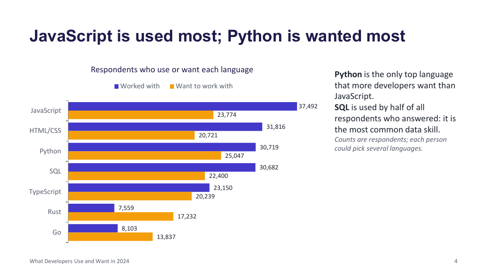
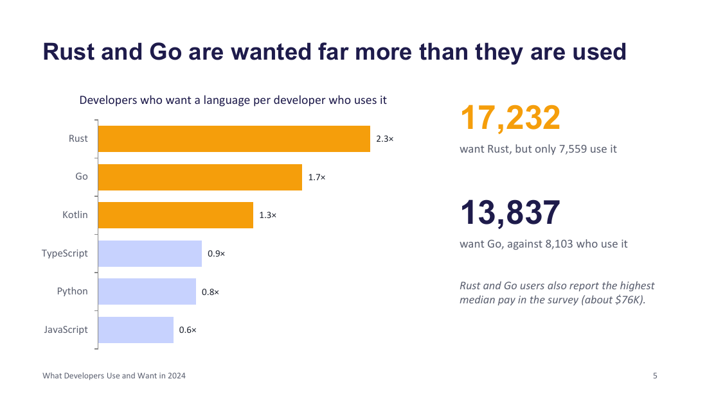
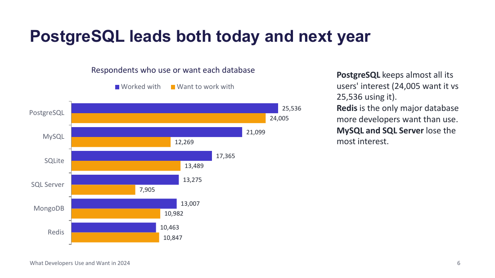
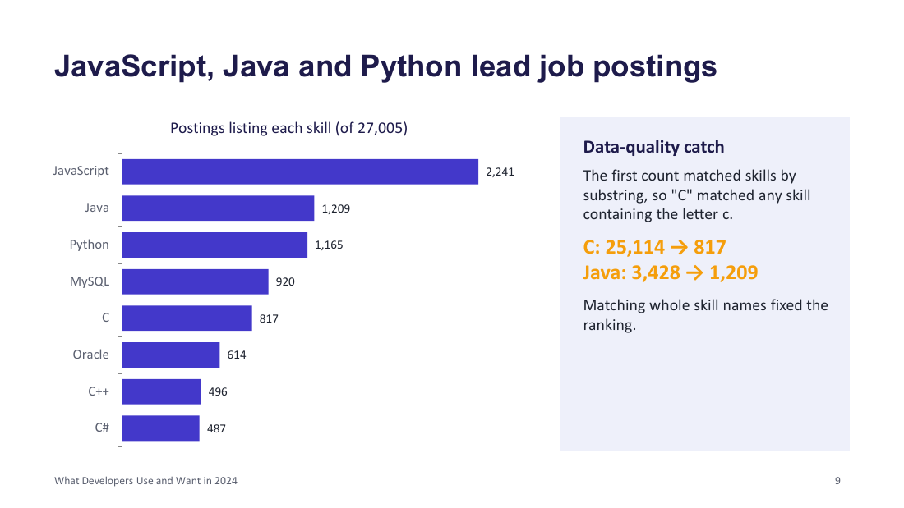
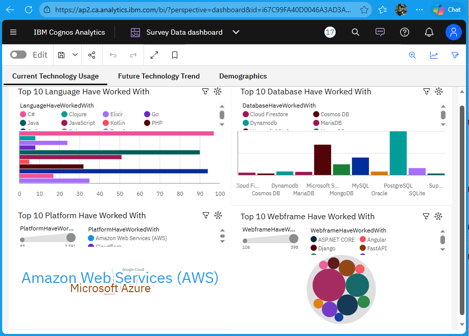

# What Developers Use and Want: 2024 Technology Trends

An analysis of the **2024 Stack Overflow Developer Survey** (65,437 responses, 185 countries) and **27,005 job postings**, covering which languages, databases, cloud platforms and web frameworks developers use today, which they want to use next, and which skills employers ask for.

> This is my capstone project for the **IBM Data Analyst Professional Certificate** (Coursera). The lab structure and datasets come from the course; the data collection, cleaning, analysis and dashboard are my own work.

## Key findings

- **JavaScript is the most used language** (37,492 respondents); **Python is the most wanted** (25,047).
- **Rust and Go have the biggest gap between interest and use:** 17,232 want Rust but 7,559 use it (2.3×); Go 13,837 vs 8,103 (1.7×).
- **PostgreSQL leads databases** for both current use (25,536) and future interest (24,005). Redis is the only major database more developers want than use.
- **AWS is the most used cloud platform** (22,191), ahead of Azure (12,850) and Google Cloud (11,605).
- **Respondents:** 58% are aged 18–34, 72% hold a bachelor's degree or higher, and the median professional coding experience is 7 years.
- **Job postings:** JavaScript (2,241), Java (1,209) and Python (1,165) are the most requested skills.

<p>
  
  
</p>
<p>
  
  
</p>

## A data-quality fix worth knowing about

The first version of the job-postings count matched skills by substring (`"c" in skills.lower()`), so **any posting with a letter "c" in its skills counted as a C job**, and every JavaScript posting also counted as Java:

| Skill | Substring match (original) | Whole skill name (fixed) |
|---|---|---|
| C | 25,114 | **817** |
| Java | 3,428 | **1,209** |
| JavaScript | 2,248 | **2,241** |

The fix splits the `Key Skills` field on `|` and compares whole skill names; see [notebook 01](notebooks/01_jobs_api_collection.ipynb) and [scripts/count_job_postings.py](scripts/count_job_postings.py).

## Dashboard

A three-tab IBM Cognos Analytics dashboard: current technology usage, future technology trends and demographics. Full export: [dashboard/survey-data-dashboard.pdf](dashboard/survey-data-dashboard.pdf).



The dashboard was built on a cleaned subset of the survey, so its counts are lower than the full-survey numbers above. In its "Top 10 Database" chart, multi-select answers such as "PostgreSQL;Redis" appear as single categories; splitting them first (as the notebooks do) would give per-database counts.

## Presentations

- **[Portfolio summary (11 slides, PDF)](report/developer-trends-portfolio.pdf):** the short version ([.pptx](report/developer-trends-portfolio.pptx))
- **[Full capstone report (23 slides, PDF)](report/data-analyst-capstone-report.pdf):** every section of the course template ([.pptx](report/data-analyst-capstone-report.pptx))

## Project structure

| Stage | Notebooks |
|---|---|
| Data collection | [01 jobs API](notebooks/01_jobs_api_collection.ipynb) · [02 salary web scraping](notebooks/02_salary_web_scraping.ipynb) · [03 web scraping practice](notebooks/03_web_scraping_practice.ipynb) |
| Data wrangling | [04 explore dataset](notebooks/04_explore_dataset.ipynb) · [05 wrangling](notebooks/05_data_wrangling.ipynb) · [06 finding duplicates](notebooks/06_finding_duplicates.ipynb) · [07 removing duplicates](notebooks/07_removing_duplicates.ipynb) · [08 missing values](notebooks/08_finding_missing_values.ipynb) · [09 imputation](notebooks/09_imputing_missing_values.ipynb) · [10 normalization](notebooks/10_normalizing_data.ipynb) |
| Exploratory analysis | [11 EDA](notebooks/11_exploratory_analysis.ipynb) · [12 distributions](notebooks/12_distributions.ipynb) · [13 outliers](notebooks/13_outliers.ipynb) · [14 correlation](notebooks/14_correlation.ipynb) |
| Visualization | [15 overview](notebooks/15_visualization_overview.ipynb) · [16 histograms](notebooks/16_histograms.ipynb) · [17 box plots](notebooks/17_box_plots.ipynb) · [18 scatter](notebooks/18_scatter_plots.ipynb) · [19 bubble](notebooks/19_bubble_plots.ipynb) · [20 pie](notebooks/20_pie_charts.ipynb) · [21 stacked](notebooks/21_stacked_charts.ipynb) · [22 line](notebooks/22_line_charts.ipynb) · [23 bar](notebooks/23_bar_charts.ipynb) |
| Presentation | [24 presentation charts](notebooks/24_presentation_charts.ipynb) |

```
├── notebooks/   # analysis pipeline, 01 → 24
├── scripts/     # standard-library scripts that reproduce every number in this README
├── dashboard/   # Cognos dashboard exports (PDF)
├── report/      # presentations (PDF + PowerPoint)
└── images/      # charts used in this README
```

## Reproduce the numbers

```bash
curl -o survey-data.csv https://cf-courses-data.s3.us.cloud-object-storage.appdomain.cloud/n01PQ9pSmiRX6520flujwQ/survey-data.csv
curl -o jobs.json "https://cf-courses-data.s3.us.cloud-object-storage.appdomain.cloud/IBM-DA0321EN-SkillsNetwork/labs/module%201/Accessing%20Data%20Using%20APIs/jobs.json"

python scripts/survey_summary.py survey-data.csv     # top technologies, demographics, pay
python scripts/interest_gap.py survey-data.csv       # want/use ratios, median pay by language
python scripts/count_job_postings.py jobs.json       # job postings per skill (substring vs exact)
```

The scripts need only the Python standard library. The notebooks need `pip install -r requirements.txt`.

## Limitations

- Survey respondents are Stack Overflow users who chose to answer, so results over-represent engaged, English-speaking developers.
- "Want to work with" measures interest, not future adoption.
- The job postings are a fixed course dataset, not live market data, and the salary table is a small illustrative sample.

## Tech stack

Python · pandas · NumPy · Matplotlib · Seaborn · Requests · BeautifulSoup · openpyxl · IBM Cognos Analytics

## Author

**Sumant Chakravarty**
